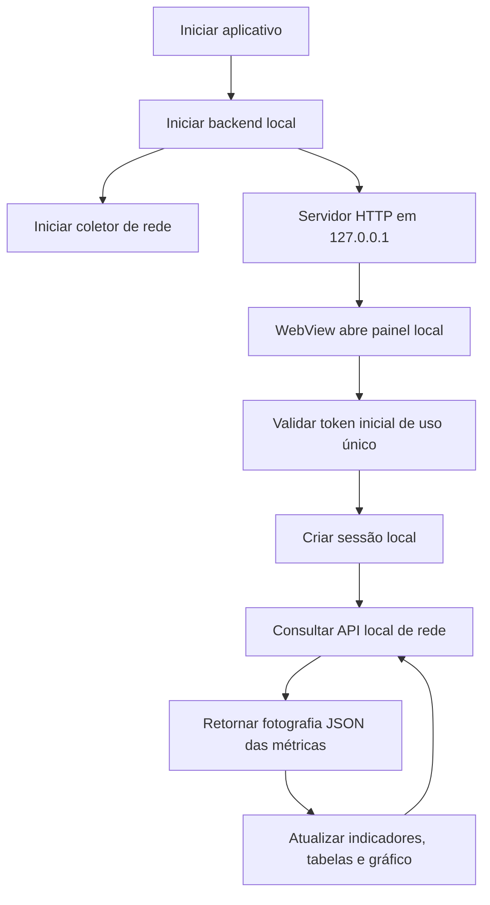
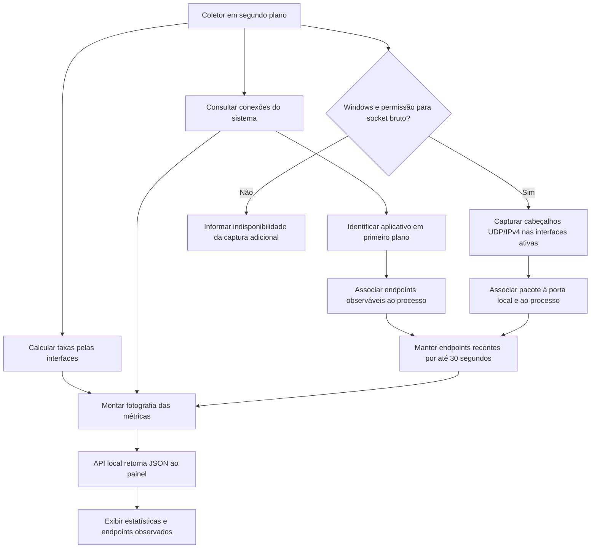

# NetWatch

Aplicativo para visualizar localmente o tráfego, as interfaces, as conexões e os endpoints de rede observáveis no Windows.

## Fluxo do monitor de rede

Os diagramas descrevem a inicialização do painel e a coleta local de informações de rede.





## Endpoints de aplicativos e jogos

A seção **IPs remotos do aplicativo em primeiro plano** lista endpoints TCP/UDP observados nos últimos 30 segundos. Quando um jogo ou navegador está em primeiro plano, o painel exibe o nome do executável e os IPs e portas associados ao processo e aos seus processos descendentes.

Navegadores compartilham conexões entre processos e abas; portanto, não é possível determinar com segurança qual site ou aba corresponde a cada endpoint. Alguns processos protegidos pelo sistema podem exigir permissões adicionais.

Para observar pacotes UDP/IPv4 de sockets sem conexão, execute o NetWatch como administrador. A captura usa sockets brutos nativos do Windows, não requer Npcap e examina somente cabeçalhos dos pacotes nas interfaces IPv4 ativas. Não armazena o conteúdo dos pacotes e não cobre IPv6. Sem privilégios, conexões já visíveis ao sistema continuam sendo listadas, e o painel informa que a captura adicional está indisponível. Executar como administrador concede privilégios elevados; use essa opção somente quando necessário.

Os endereços exibidos são **endpoints de rede, não identidades de pessoas**. Jogos podem usar servidores ou relays e sites podem usar CDNs; outros participantes não necessariamente se conectam diretamente ao computador. A captura não revela endereços que a arquitetura do serviço não expõe. Se vários processos compartilharem a mesma porta UDP, a atribuição ambígua é ignorada.

## Dados e privacidade

O coletor calcula localmente o tráfego, as interfaces, as conexões e os endpoints. O painel consulta o backend por loopback (`127.0.0.1`), usando uma sessão local autenticada. O NetWatch não envia a lista de endpoints observados e não faz varreduras ou consultas externas de IP.

As sondagens externas de latência estão desativadas por padrão: nenhum destino externo de teste é configurado automaticamente. Isso descreve as conexões iniciadas pelo NetWatch; não impede que outros programas com acesso à conta do Windows leiam arquivos ou observem o sistema.

## Desenvolvimento

Requisitos: Windows 10/11, Python 3.11+ com pip, Node.js 20+, Rust estável (MSVC), Microsoft C++ Build Tools e WebView2. Consulte os [pré-requisitos oficiais do Tauri](https://v2.tauri.app/start/prerequisites/).

Na pasta do projeto, em PowerShell:

```powershell
powershell -ExecutionPolicy Bypass -File scripts/setup.ps1
npm.cmd run dev
```

O script prepara o ambiente Python, instala as dependências e gera o CSS.

## Gerar instalador

```powershell
npm.cmd run build
```

O processo empacota o backend e a interface com Tauri/NSIS. O instalador fica em `src-tauri/target/release/bundle/nsis/`; a máquina de destino não precisa de Python ou Node. O instalador não é assinado.

## Arquitetura

- `app/network.py`: métricas de tráfego, interfaces, conexões e observação de endpoints, incluindo captura UDP/IPv4 nativa do Windows.
- `app/controllers.py`: rotas do painel e API local de rede.
- `app/templates/` e `app/static/`: interface, gráficos e tabelas.
- `app/__init__.py`: criação da aplicação Flask e cabeçalhos de segurança.
- `backend.py`: inicialização do coletor e servidor Waitress em loopback e porta aleatória.
- `src-tauri/`: janela nativa e ciclo de vida do backend.

## Verificação

```powershell
.venv/Scripts/python.exe -m unittest discover -s tests -v
npm.cmd run css
```
